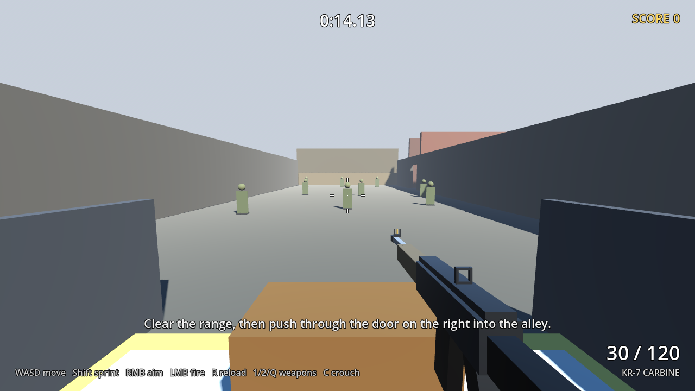
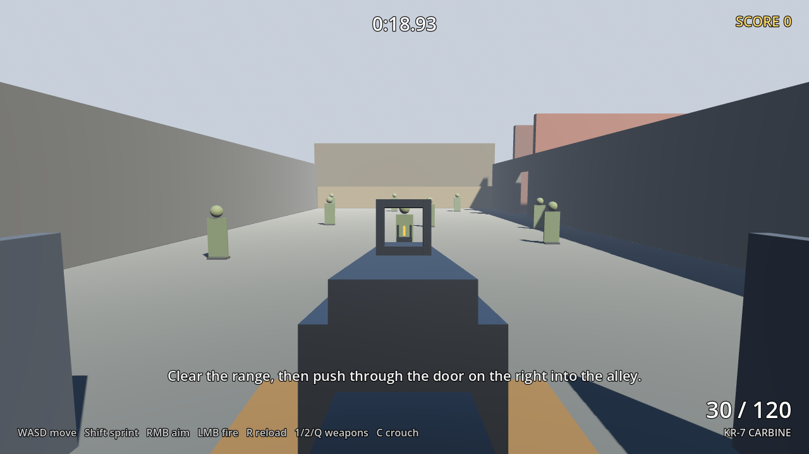

# Range Day

A tiny first-person gunplay-feel study in Godot 4.7.2: one rifle, one pistol, one
timed course from a shooting range into an urban alley. Original throughout; all
audio is procedurally generated.




## Play

- Web build: `docs/` (deployed by `.github/workflows/pages.yml` to GitHub Pages on
  pushes to `main`; enable Pages with source "GitHub Actions" in the repo settings).
- Add `?low` to the URL to disable shadows and MSAA on weak GPUs.
- Controls: WASD move, Shift sprint, RMB aim, LMB fire, R reload, 1/2/Q or wheel to
  swap, C crouch, Space jump, E start the course on the white pad, Enter restart,
  Esc release the mouse.

## Build

```bash
python3 tools/gen_sfx.py                              # regenerate assets/sfx/*.wav
godot --headless --path . --import
godot --headless --path . --export-release "Web" docs/index.html
```

## Test

```bash
godot --headless --path . -- --autotest                # 40 gameplay/timing checks
python3 -m http.server 8765 --directory docs &          # then:
SHOTS=/tmp/shots node tests/verify_web.js               # headless Chromium (Playwright)
```

See `NOTES.md` for what is closest to the reference feel, what is missing and the
three changes that would close the gap most.
